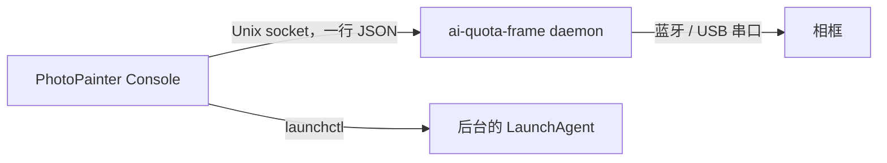

# PhotoPainter Console

PhotoPainter Console 是一个 macOS 原生应用，用图形界面操作 PhotoPainter 相框：查看设备状态、管理相框上的应用、手动推图、配对、Wi-Fi 配置和 USB 维护。它是 [ai-quota-frame](https://github.com/M1nt-Ch0c0/ai-quota-frame) 后台的前端，本身不连接蓝牙。

每个页面能做什么、后台怎样排队执行操作，见 [电脑端、控制台与网页插件](https://github.com/M1nt-Ch0c0/esp32s3/blob/main/docs/07-clients.md#macos-控制台)。这一页只讲本仓库：它和后台的关系、怎样构建。

## 和 ai-quota-frame 后台的关系



- 控制台的每个操作都是一条发给后台的请求。后台把它放进唯一的设备操作队列，和自动推图一起按顺序执行。控制台每 2 秒请求一次 `snapshot`，读取后台状态和最近一次操作的结果。
- socket 路径是 `~/Library/Application Support/ai-quota-frame/console/bridge.sock`。后台只在 macOS 上、并且用蓝牙推送时才打开它，见 [`console` 子命令](https://github.com/M1nt-Ch0c0/esp32s3/blob/main/docs/07-clients.md#console-子命令)。
- 控制台要求后台装在 `~/Library/Application Support/ai-quota-frame/`，LaunchAgent 标识为 `com.m1ntch0c0.ai-quota-frame`。“启动后台”“重启后台”“停止后台”按钮通过 `launchctl` 操作这个 LaunchAgent。
- 哪些操作可用由后台的能力清单决定，界面按清单启用或禁用按钮，并显示不可用的原因。所以控制台要和配套版本的后台一起使用。

本仓库只包含控制台。后台程序、它的配置和设备凭据都由 ai-quota-frame 管理，安装方法见 [上手使用](https://github.com/M1nt-Ch0c0/esp32s3/blob/main/docs/02-getting-started.md)。

## 构建

需要 Apple Silicon Mac、macOS 14 或更新版本，以及 Xcode Command Line Tools。

```sh
sh build.sh
open "dist/PhotoPainter Console.app"
```

`build.sh` 用 `swiftc` 编译 `Sources/` 下的四个文件，生成 `Info.plist`，再做本机临时签名（ad-hoc）。产物是 `dist/PhotoPainter Console.app`，`dist/` 不进版本库。

| 项目 | 值 |
|---|---|
| 应用标识 | `com.m1ntch0c0.photopainter-console` |
| 版本 | 0.4.1（build 6），在 `build.sh` 里修改 |
| 最低系统 | macOS 14，arm64 |

## 源码

| 文件 | 内容 |
|---|---|
| `Sources/ConsoleSocket.swift` | Unix socket 客户端：发送一行 JSON，读取一行回复，4 秒超时 |
| `Sources/Models.swift` | 后台状态的数据结构、请求发送与轮询、LaunchAgent 控制 |
| `Sources/ConsoleApp.swift` | 应用入口、侧边栏和各页面框架、运行总览与设备页 |
| `Sources/OperationsView.swift` | 连接、图片推送、应用通信、Wi-Fi、USB 维护等操作页和确认对话框 |

## 请求格式

每个请求是一行 JSON，`action` 字段指定操作，其余字段是操作参数。会修改设备的操作（安装、删除、写 Wi-Fi、USB 写入等）在界面上先弹出确认对话框，确认后才带上 `confirmed: true` 发出。

后台的回复包含：

| 字段 | 内容 |
|---|---|
| `state` | 后台状态快照，包括自动推送、最近采集、推图进度、设备状态、能力清单 |
| `state.operation_result_action`、`state.operation_result` | 最近一次完成的操作和它的结果 |
| `package` | `inspect` 检查应用包得到的信息：应用 ID、版本、ABI、字节数、摘要 |
| `image` | `inspect-image` 检查 PNG 得到的信息：字节数、摘要、宽、高 |
| `error` | 错误信息 |

安装应用包和推图时，控制台先让后台检查文件并返回摘要，执行请求里带上这个摘要，后台执行前再核对一次。

## 隐私

控制台不读取后台的环境配置、设备凭据、服务日志和 Flash 备份内容。Wi-Fi 密码在密码输入框里输入，只通过 socket 交给后台，不经过 shell 或命令行参数。
